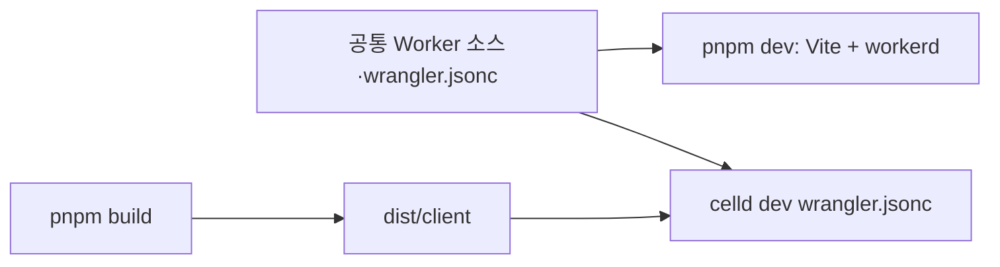

# Cloudflare Vite로 개발하고 celld로 실행하는 React + KV 카운터

공식 문서 확인일: 2026-11-26. celld 이미지는 `v0.6.3`으로 고정했습니다.

React 화면과 Worker HTTP API를 Cloudflare Vite 플러그인으로 개발하고, 같은 Worker 소스와 원본 `wrangler.jsonc`를 celld에서 실행하는 **학습용 프로젝트**입니다. 일상 개발에는 Node 24와 pnpm만 필요합니다. 로컬 workerd와 celld 확인에는 Cloudflare 로그인이나 클라우드 bucket이 필요하지 않습니다.

여러 사용자가 동시에 증가시키는 정확한 공유 카운터가 필요하면 아래의 동시성 한계를 먼저 확인하세요. 이 예제는 KV 바인딩과 저장 흐름을 배우기 위한 것입니다.

## 1. 바로 실행

프로젝트 루트에서 실행합니다.

```sh
pnpm install --frozen-lockfile
pnpm dev
```

브라우저에서 <http://localhost:5173>을 엽니다. Cloudflare Vite 플러그인이 React와 로컬 workerd의 Worker·KV를 연결합니다. 종료는 Ctrl+C입니다. Docker나 별도의 API 프록시를 시작하지 않습니다.

화면에서 `1 올리기`, `새로 읽기`, `0으로 초기화`를 사용할 수 있습니다. 서버의 KV key `count` 하나를 모든 브라우저가 공유합니다. 다른 브라우저의 변경은 `새로 읽기`나 페이지 새로고침으로 확인합니다.

celld에서 확인하는 방법은 6절을 참고하세요. workerd와 celld의 KV 데이터는 별개이며 자동으로 공유하거나 이전하지 않습니다.



## 2. 구성과 파일

| 파일 | 역할 |
| --- | --- |
| `src/App.tsx` | React UI, 초기 조회, 증가 및 초기화 요청, 로딩과 오류 처리 |
| `src/main.tsx` | React 진입점 |
| `src/style.css` | 화면 스타일 |
| `worker/index.ts` | KV에 접근하는 Worker API |
| `wrangler.jsonc` | Worker, KV namespace, React 정적 파일 바인딩 |
| `worker-configuration.d.ts` | `wrangler types`가 생성한 Env 및 런타임 타입 |
| `vite.config.ts` | React와 Cloudflare Vite 플러그인의 통합 개발·빌드 |
| `Dockerfile` | Node에서 빌드한 후 celld 개발 모드 실행 |
| `compose.yaml` | 기본 레시피: R2 fleet bucket과 공식 celld 서버, Caddy HTTPS |
| `compose.bind.yaml` | 독립 bind 레시피: R2 없이 ./data에 로컬 저장 |
| `.env.oci.example` | Vault에 등록할 도메인·R2 변수 참고 목록 |
| `pnpm-lock.yaml` | pnpm 의존성 버전과 무결성 고정 |

브라우저에서는 React가 실행됩니다. 개발 시 플러그인이, celld 확인 시 celld가 `/api/counter`를 Worker로 전달합니다. celld는 `dist/client/`의 HTML/CSS/JS를 제공합니다. Worker가 `env.COUNTER_KV`로 KV에 접근하며 KV 자격증명을 브라우저에 전달하지 않습니다.

이 Dockerfile은 celld 자체를 컨테이너화합니다. 실행 중인 앱에는 Docker 소켓 연결이나 별도의 Node HTTP 서버가 필요하지 않습니다. 이미지에 남긴 Node와 `esbuild`는 `celld dev` 및 `celld deploy`의 Worker 빌드에 사용됩니다.

## 3. Wrangler 설정의 의미

`wrangler.jsonc`는 Cloudflare 호환 설정 형식입니다. 기본 예제는 Cloudflare에 배포하지 않으며 Wrangler CLI 로그인도 필요하지 않습니다.

```json
{
  "name": "celld-react-kv-counter",
  "main": "worker/index.ts",
  "compatibility_date": "2026-01-01",
  "assets": {
    "directory": "./dist/client",
    "binding": "ASSETS",
    "not_found_handling": "single-page-application",
    "run_worker_first": ["/api", "/api/*"]
  },
  "kv_namespaces": [
    {
      "binding": "COUNTER_KV",
      "id": "react-counter-data"
    }
  ]
}
```

`directory`는 celld가 읽을 React 빌드 결과입니다. Cloudflare Vite 플러그인은 자체 client 빌드 경로를 사용합니다. `run_worker_first`는 API를 먼저 Worker로 보내어 SPA HTML 응답과 API 응답이 섞이지 않게 합니다. `ASSETS`는 Worker에서 `env.ASSETS.fetch(request)`로 정적 파일을 요청하는 바인딩입니다. [정적 파일 문서](https://celld.dev/docs/services/static-assets/)

`binding`은 코드에서 접근하는 이름이고 `id`는 namespace의 식별자입니다. celld에서는 `id`에 임의 문자열을 사용할 수 있습니다. 이름을 바꾸면 다른 namespace를 읽게 되므로 기존 값이 사라진 것처럼 보일 수 있습니다. [KV 문서](https://celld.dev/docs/services/kv/)

Worker의 `Env`는 `wrangler.jsonc`에서 생성합니다. 바인딩이나 호환성 설정을 변경하면 아래 명령으로 타입을 갱신하세요. 생성 파일은 직접 수정하지 않습니다. 타입 생성에는 Cloudflare 로그인이 필요하지 않습니다.

```sh
pnpm cf-typegen
```

## 4. API 동작

| 요청 | 처리 | 성공 응답 |
| --- | --- | --- |
| `GET /api/counter` | KV 값 조회. 없으면 0 | `{"count":0}` |
| `POST /api/counter` | 현재 값에 1을 더해 저장 | `{"count":1}` |
| `DELETE /api/counter` | key 삭제, 0으로 표시 | `{"count":0}` |

POST body는 필요하지 않습니다. API 응답은 `Cache-Control: no-store`를 사용합니다. 알 수 없는 API는 404, 지원하지 않는 메서드는 405, 숫자 최대값은 409를 반환합니다.

```sh
curl -sS http://localhost:5173/api/counter
curl -sS -X POST http://localhost:5173/api/counter
curl -sS http://localhost:5173/api/counter
```

초기화는 값을 실제로 지우는 명령입니다.

```sh
curl -sS -X DELETE http://localhost:5173/api/counter
```

React는 상대 URL `/api/counter`를 호출하므로 기본 실행에서는 CORS 설정이 필요하지 않습니다. 요청 중에는 버튼을 비활성화합니다. 저장 요청의 응답을 받지 못한 경우 결과가 불확실할 수 있으므로 자동으로 재시도하지 않고 현재 값을 다시 읽도록 안내합니다.

## 5. 데이터 보관과 수정 후 실행

Cloudflare Vite 개발 상태는 기본적으로 `.wrangler/` 아래에 보관됩니다. 호스트의 celld 개발 모드는 `.celld/dev`를 사용하며, 선택적 Compose는 `/app/.celld`를 프로젝트의 `./data`에 연결합니다. 아래는 Docker로 celld를 확인할 때의 명령입니다. [개발 모드와 상태 저장](https://celld.dev/docs/#develop-an-application-locally)

```sh
# 중지 — data/ 유지
docker compose -f compose.bind.yaml down

# 같은 프로젝트를 다시 실행
docker compose -f compose.bind.yaml up -d

# 소스·설정·의존성 변경 후 celld 확인 이미지 갱신
docker compose -f compose.bind.yaml up --build -d --wait app
```

값을 올린 뒤 `down`과 `up -d`를 실행하여 값이 유지되는지 직접 확인할 수 있습니다. 현재 개발 구성은 bind mount이므로 `docker compose down -v`로도 `./data`는 삭제되지 않습니다. `data/`를 삭제하거나 celld의 `--clean`을 사용하면 개발 데이터가 삭제됩니다.

기본 Compose 프로젝트 이름을 고정했기 때문에 같은 예제 디렉터리를 복제해도 같은 이름을 쓰면 기존 컨테이너와 겹칠 수 있습니다. 별개의 실습 인스턴스에는 `docker compose -p 다른이름 ...`과 서로 다른 호스트 포트를 사용하세요.

## 6. 같은 소스와 설정을 celld에서 확인하기

일상 개발은 `pnpm dev`로 진행합니다. React HMR과 Worker 변경 반영은 Cloudflare Vite 플러그인이 담당합니다. 5173이 사용 중이면 `pnpm dev --port 5174`로 포트를 지정합니다.

celld를 설치한 호스트에서는 다음 두 명령으로 별도 확인합니다.

```sh
pnpm build
pnpm exec celld dev wrangler.jsonc --port 8080
```

`pnpm exec`는 프로젝트의 esbuild를 PATH에 넣습니다. celld v0.6.3은 [공식 설치 안내](https://celld.dev/docs/#install)를 따라 별도로 준비합니다. 화면은 <http://localhost:8080>이며 종료는 Ctrl+C입니다. Worker는 원본 `worker/index.ts`를 celld가 번들링하고 React 정적 파일은 `dist/client`에서 읽습니다. React 변경을 확인하려면 다시 빌드합니다.

### 플러그인과 celld 사이의 최소 호환 처리

- **루트 `wrangler.jsonc`를 직접 전달합니다.** 플러그인이 생성한 `dist/celld_react_kv_counter/wrangler.json`에는 celld가 지원하지 않는 키와 규칙이 있으므로 celld 입력으로 사용하지 않습니다.
- 플러그인은 `dist/client/.assetsignore`를 생성하지만 celld v0.6.3은 이 파일을 거부합니다. `build` 마지막의 Node 한 줄이 이 생성 파일만 제거합니다.
- 현재 생성 파일은 `wrangler.json`, `.dev.vars`를 제외하는 내용이며 두 파일은 client 산출물에 없습니다. 민감한 파일을 `public/`이나 client 산출물에 넣지 마세요. 사용자 정의 제외 규칙을 도입한다면 단순 제거 대신 배포 자산 구성을 재검토해야 합니다.
- `pnpm exec vite build`는 마지막 호환 처리를 생략하므로 celld 확인 전에는 `pnpm build`를 사용합니다.

### Docker를 사용하는 경우

호스트에 celld를 설치하지 않고 확인하려면 기존 Docker 구성을 사용할 수 있습니다.

```sh
docker compose -f compose.bind.yaml up --build --abort-on-container-exit app
```

8080에서 확인하고 Ctrl+C로 중지합니다. 이미지 내부에서도 `pnpm build` 후 원본 `wrangler.jsonc`로 실행합니다. 소스 bind mount와 감시는 사용하지 않으며 변경 후 이미지를 다시 빌드합니다. Vite 개발 서버와는 독립된 확인 환경입니다.

백그라운드 실행과 상태 준비 대기는 package.json 명령으로 실행할 수 있습니다.

```sh
pnpm bind:start
pnpm bind:logs
# 종료: pnpm bind:stop
```

`bind:start`는 이미지 빌드와 컨테이너 시작을 함께 수행합니다. 로그 보기의
Ctrl+C는 서버를 중지하지 않으므로 종료할 때는 `bind:stop`을 사용합니다.

## 7. 기본 R2 레시피와 디렉터리 bind 레시피

기본 `compose.yaml`은 R2에 배포와 영속 상태를 저장하는 레시피입니다.
`compose.bind.yaml`은 R2 없이 `./data:/app/.celld`를 연결하고 `celld dev`로
실행하는 독립 레시피입니다. 실제 로컬 저장소는 `./data/dev`에 만들어집니다.
두 파일을 `-f compose.yaml -f compose.bind.yaml`로 합치지 않습니다.

| 항목 | 기본 compose.yaml | compose.bind.yaml |
| --- | --- | --- |
| 저장 기반 | R2 fleet bucket | 프로젝트의 ./data |
| 실행 방식 | 공식 이미지의 celld fleet node | 프로젝트 이미지의 celld dev |
| 클라우드 자격증명 | 필요 | 불필요 |
| HTTPS | Caddy 포함 | 로컬 HTTP 8080 |

R2 방식도 로컬 SQLite·복제 작업 상태가 필요하여 `./data/celld-r2`를 사용합니다.
이 디렉터리는 R2를 대신하는 저장소가 아니며, bind 방식의 `./data/dev`와 다릅니다.

| 서비스 | 역할 |
| --- | --- |
| `deploy` | 프로젝트 이미지에서 빌드된 Worker·정적 자산을 R2에 배포하고 종료 |
| `app` | 공식 celld v0.6.3 이미지로 R2의 배포를 읽고 실행 |
| `caddy` | HTTPS와 app으로의 리버스 프록시 |

`.env.oci.example`을 참고해 Vault의 정확한 폴더
`env/oci/celld-test.illuwa.click`에 도메인·R2 bucket·S3 API 자격증명을
변수별 Secure Note로 등록합니다. 이름은 변수명, Notes 첫 줄은 값입니다.
자세한 준비·실행 순서는 [OCI 배포 안내](deploy/README.md)를 따릅니다.

```sh
rbw unlock
rbw sync
pnpm deploy
pnpm server:start
pnpm server:logs
# 종료: pnpm server:stop
```

명령은 rbw-env의 프로세스 환경 주입 모드를 사용하고 기본 `compose.yaml`을 선택합니다.
`--env-file /dev/null`로 기존 `.env` 자동 로드를 차단하며 실행용 환경 파일은 만들지 않습니다.
각 명령이 성공한 뒤 다음 명령을 실행합니다. `deploy`는 R2에 실제로
업로드하고, `server:start`는 celld와 Caddy를 실행합니다. 일상 개발은 `pnpm dev`입니다.
bind Compose와 기본 Compose는 프로젝트 이름과 8080 포트를 공유하므로
같은 호스트에서 전환할 때는 먼저 기존 구성을 중지합니다.

### 로컬 R2 테스트를 마치고 OCI로 넘기기

**OCI와 같은 R2 bucket을 쓰는 로컬 앱 컨테이너는 OCI 기동 전에 종료합니다.**
이 레시피의 `app:8081`은 각 호스트의 Docker 네트워크 안에서만 유효합니다.
로컬 node를 켜둔 채 OCI node를 시작하면 두 node가 같은 주소를 광고해
카운터 API가 500을 반환하고 `remote RPC owner remained stale until the retry deadline`
오류가 날 수 있습니다. `healthy`만으로 앱이 정상이라고 판단하지 마세요.

로컬 R2 컨테이너를 실행한 **기기와 Docker context**에서 확인하고 종료합니다.

```sh
docker context show
docker ps --filter name=celld-react-kv-counter
pnpm server:handoff
docker ps --filter name=celld-react-kv-counter-app-1
```

`server:handoff`는 앱 컨테이너만 SIGTERM으로 종료하고 최대 60초 기다립니다.
Vault 잠금 해제나 Compose 환경변수는 필요 없으며 데이터와 Caddy는 보존합니다.
컨테이너가 없다는 오류가 나면 다른 context에서 실행 중인지 확인합니다.
`docker compose -p`로 프로젝트 이름을 바꿨다면 실제 app 컨테이너 이름으로
`docker stop --timeout 60 <컨테이너 이름>`을 실행합니다.
전체 구성 종료는 기존 `pnpm server:stop`을 사용합니다.

일상 개발인 `pnpm dev`는 로컬 workerd를 사용하므로 이 문제와 별개입니다.
`pnpm dev`를 시작해도 이전에 켜둔 R2 컨테이너가 자동으로 종료되지는 않습니다.
로컬 R2 테스트는 OCI와 다른 전용 bucket을 쓰는 것이 안전합니다.
이 명령을 OCI에서 실행하면 OCI 앱이 중지되므로 로컬 테스트 기기에서만 실행합니다.

R2는 코드·정적 자산·KV 영속 상태를 보관하는 fleet bucket입니다.
**workerd나 celld 로컬 개발 데이터는 R2로 자동 이전되지 않습니다.**
실행 중인 node는 기본 30초 간격으로 새 배포를 확인합니다.
[배포 갱신](https://celld.dev/docs/#deploy-an-application)

## 8. KV 카운터의 동시성 한계

증가는 다음 두 API 호출로 구성됩니다.

```ts
const current = Number(await env.COUNTER_KV.get('count') ?? '0')
const count = current + 1
await env.COUNTER_KV.put('count', String(count))
```

이 전체 과정은 원자적 연산이 아닙니다. A와 B가 모두 0을 읽고 각각 1을 저장하면 두 번 눌러도 최종 값은 1입니다. 초기화와 증가가 동시에 실행되는 경우도 경쟁할 수 있습니다. 버튼을 비활성화하는 것은 같은 화면의 중복 클릭을 줄일 뿐 다른 브라우저의 요청을 직렬화하지 않습니다.

celld KV는 namespace 소유 cell에서 읽으므로 Cloudflare KV의 eventual consistency와는 다릅니다. 그렇더라도 별도의 `get`과 `put`을 합친 atomic increment가 제공되는 것은 아닙니다. 공식 문서도 갱신이 잦은 카운터에 Durable Object를 권합니다. [KV 일관성과 용도](https://celld.dev/docs/services/kv/)

정확한 공유 카운터로 발전시키려면 하나의 이름으로 식별한 Durable Object에 카운터를 두고 그 객체의 storage transaction을 사용하세요. React/API 주소는 유지하고 Worker의 저장 처리를 바꿀 수 있습니다. DO의 storage와 KV namespace 바인딩은 서로 다른 저장소입니다. [Durable Objects 문서](https://celld.dev/docs/services/durable-objects/)

## 9. 검증 범위

최초 예제 작성 환경에서 아래 검증은 통과했습니다.

- 타입 검사와 Vite 프로덕션 빌드(현재 명령: `pnpm build`)
- `esbuild`의 Worker ESM 번들링
- Worker 로직을 Node에서 실행하고 메모리 KV 바인딩으로 조회·증가·초기화, 상태 코드, 캐시 헤더, 숫자 범위와 정적 파일 fallback 확인
- 위 mock 환경에서 겹친 read/write 증가가 유실될 수 있음을 확인
- 두 Compose YAML 구문 파싱과 공식 celld 문서에 대한 설정 검토

최초 작성 환경에서는 Docker 실행 검증을 하지 못했습니다. 이전 프록시 개발 구성 개선 시에는 아래 항목을 확인했습니다(현재 구성과 구분).

- 타입 검사와 React 빌드 통과(현재 명령: `pnpm build`)
- 당시 로컬 개발 Compose 설정 검사 통과
- 당시 별도 R2 최소 예제의 Compose 설정 검사 통과(현재는 OCI 구성으로 통합)
- Docker 이미지 빌드와 컨테이너 기동, API healthcheck 통과
- Worker 응답에 임시 검증 헤더를 추가한 뒤 이미지 재빌드 없이 API 응답에서 확인하고, 원복 후 헤더 제거도 확인
- 5174 포트의 Vite에서 React 페이지, `/api/counter` 프록시 및 미등록 API의 JSON 404 응답 확인. 기본 5173 포트가 사용 중일 때는 충돌 오류 확인
- 검증 중 카운터 GET 값 `28` 유지. 검증용 Vite 프로세스는 종료

R2 업로드·R2 서버 실행과 별도의 장애 복구·영속성 테스트는 수행하지 않았습니다.

Cloudflare Vite 전환 후 확인한 항목:

- `pnpm build` 및 pnpm 기반 Docker 이미지 빌드 통과
- 실제 workerd와 celld 양쪽에서 카운터 GET, no-store, 미등록 API의 JSON 404, 미지원 메서드 405, React HTML과 SPA fallback 확인
- 임시 celld 컨테이너에서 POST → GET → DELETE로 KV 변경 확인. 기존 `data/`는 사용하지 않음
- 원본 `wrangler.jsonc`와 `dist/client`의 직접 연결 확인
- `.assetsignore`가 있을 때의 celld 실패와 빌드 후 제거를 통한 해결 확인
- 호스트 celld 바이너리 실행은 미검증. celld 런타임 검증은 v0.6.3 Docker 이미지에서 수행

## 공식 참고 문서

- [celld 문서](https://celld.dev/docs/)
- [celld v0.6.3 공식 이미지](https://github.com/denoland/celld/pkgs/container/celld)
- [KV](https://celld.dev/docs/services/kv/)
- [Static assets](https://celld.dev/docs/services/static-assets/)
- [Durable Objects](https://celld.dev/docs/services/durable-objects/)
- [Security](https://celld.dev/docs/security/)
- [Vite 시작하기](https://vite.dev/guide/)
